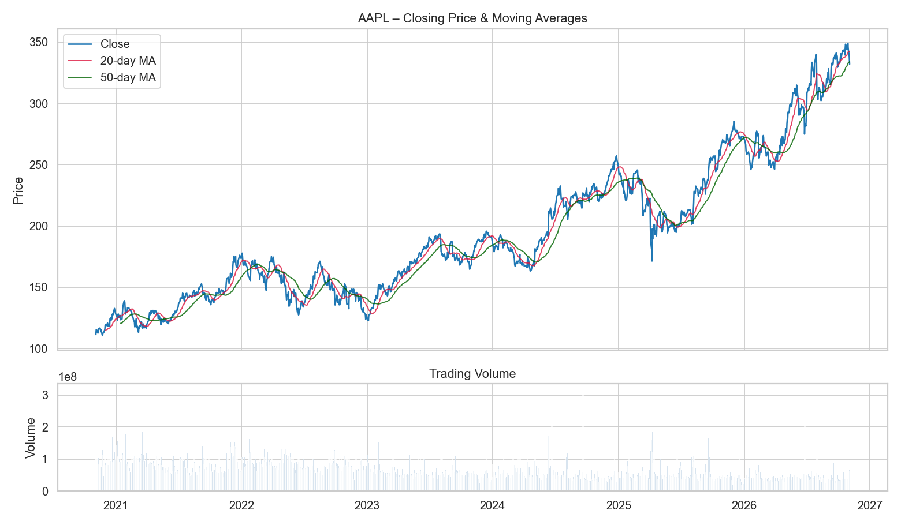
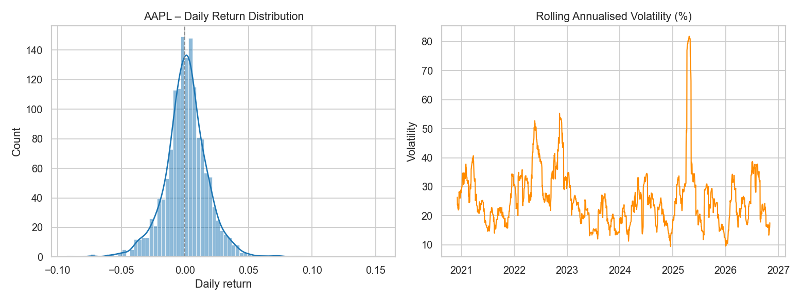
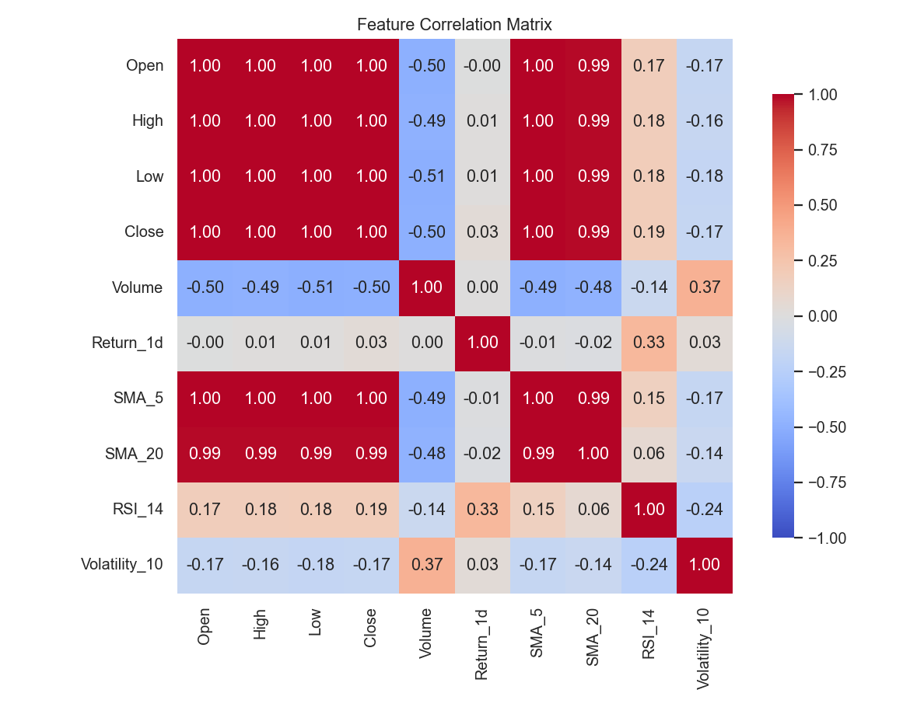
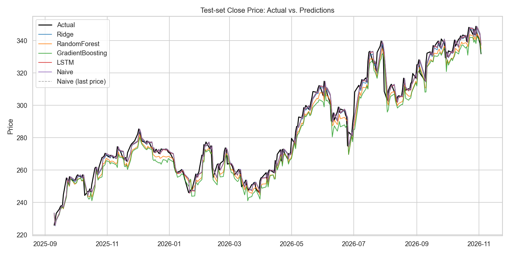
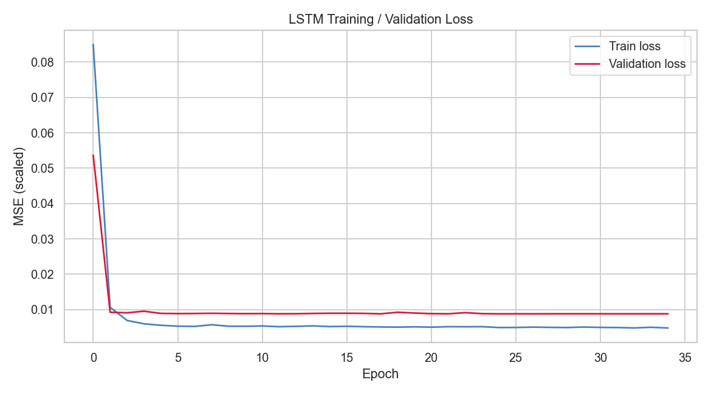
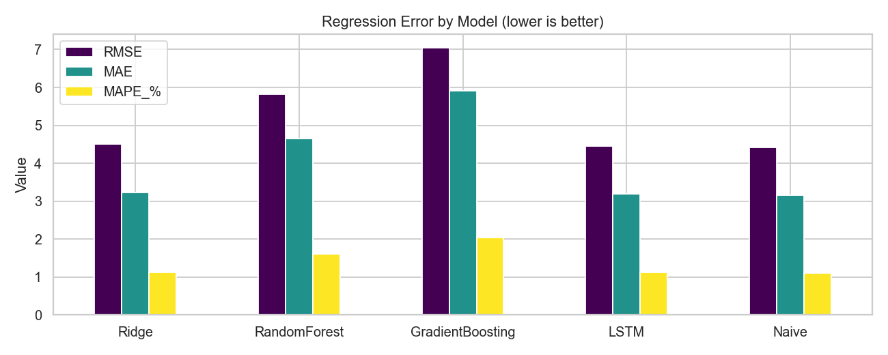
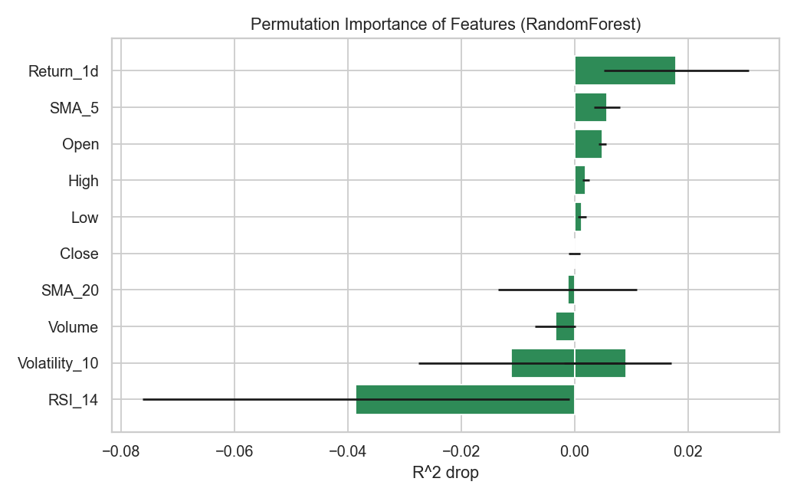

# Minor Project Report
## StockCast — Stock Price Prediction using LSTM & Classical Machine Learning

| | |
|---|---|
| **Author** | Hamid Kamal |
| **Project** | StockCast — Stock Price Prediction (ML Minor Project) |
| **Internship period** | 4 November 2026 – 5 December 2026 |
| **Domain** | Machine Learning · Time-Series Forecasting |
| **Dataset** | Apple (AAPL) daily OHLCV, Yahoo Finance, Nov 2020 – Nov 2026 |
| **Models** | LSTM (PyTorch), Ridge, Random Forest, Gradient Boosting |

---

## 1. Abstract

Forecasting stock prices is a classic and difficult time-series problem that
attracts researchers, analysts and investors alike, because a reliable
prediction system supports trading decisions by indicating the likely **future
direction** of the market. This project builds a complete, reproducible
forecasting pipeline that (a) engineers technical features from **real** Apple
(AAPL) daily OHLCV data pulled from Yahoo Finance, (b) forecasts the **next-day
return** with a recurrent **Long Short-Term Memory (LSTM)** network alongside
three classical regression baselines, and (c) evaluates every model on a
strictly chronological held-out test period against a **naive random-walk
benchmark**. The LSTM is the best trained model on price level
(R² = 0.980, MAPE = 1.11%), statistically matching the persistence baseline —
while day-ahead **direction** accuracy stays near chance for all models, an
honest reflection of how hard short-horizon markets are to time.

---

## 2. Problem Statement

Given the historical daily price history of a stock, predict the **closing price
of the next trading day** and whether the price will move **up or down**.
Formally, a window of `L = 60` consecutive trading days
`Xₜ = [xₜ₋₅₉, …, xₜ]` is mapped to the next-day return
`rₜ₊₁ = (Closeₜ₊₁ − Closeₜ) / Closeₜ`, from which the forecast close is
reconstructed as `Closeₜ · (1 + r̂ₜ₊₁)`.

> **Why forecast the return, not the raw price?** Daily prices are
> non-stationary and strongly trending. Tree models (Random Forest / Gradient
> Boosting) cannot extrapolate beyond the price range seen in training, so
> forecasting absolute price on a nearly-tripling series gives them a *negative*
> R². Forecasting the stationary return removes this artefact and makes the
> comparison fair — a deliberate, standard design choice.

---

## 3. Dataset

| Property | Value |
|---|---|
| Source | Yahoo Finance via `yfinance` (ticker **AAPL**) |
| Period | 2020-11-04 → 2026-11-03 (~6 years) |
| Rows | 1,506 trading days |
| Start → End close | 111.40 → 331.90 |
| Total return | +197.9% |
| Price range (min / max) | 110.53 / 348.91 |
| Mean daily return | +0.088% |
| Annualised volatility | 27.6% |
| Columns | Date, Open, High, Low, Close, Volume |

The dataset is cached at `data/raw/AAPL.csv`; any other Kaggle/Yahoo OHLCV CSV
can be dropped in with zero code changes (see `README.md`).

---

## 4. Methodology

### 4.1 Feature engineering
From the raw OHLCV bars we derive 5 technical indicators, giving **10 features**:
`Return_1d`, `SMA_5`, `SMA_20`, `RSI_14` (momentum), `Volatility_10`, plus the
raw `Open/High/Low/Close/Volume`.

### 4.2 Sequence construction
A **60-day sliding window** produces one supervised sample per trading day; the
target is the **next-day return**.

### 4.3 Data split & leakage control
- **Chronological 80/20 split** — train on the earlier 80% (1,156 windows), test
  on the most recent 20% (290 windows). **No shuffling**, so the future never
  leaks into the past.
- All `MinMaxScaler` parameters are **fit on the training set only** and reused
  for the test set and for live forecasting.

### 4.4 Models
| Model | Input | Notes |
|---|---|---|
| **Ridge** | tabularised window | regularised linear baseline |
| **Random Forest** | tabularised window | 300 trees |
| **Gradient Boosting** | tabularised window | 300 stagged trees, lr = 0.05 |
| **LSTM** | full 60-day sequence | 2 layers, 64 hidden, dropout 0.2, Adam, MSE, early stopping |
| *Naive (benchmark)* | — | forecast close = last close (random-walk) |

### 4.5 Evaluation metrics
- **Price level:** RMSE, MAE, MAPE, R² on the reconstructed close.
- **Trend direction:** share of days where the sign of the move is correct,
  compared against the share of up-days (the "always-long" naive benchmark).

---

## 5. Results

### 5.1 Price-level accuracy (test set, 290 days)

| Model | RMSE | MAE | MAPE (%) | R² |
|---|---:|---:|---:|---:|
| **LSTM** (best trained) | 4.45 | 3.19 | 1.11 | 0.980 |
| Ridge | 4.50 | 3.23 | 1.13 | 0.979 |
| *Naive benchmark* | 4.42 | 3.16 | 1.10 | 0.980 |
| Random Forest | 5.81 | 4.65 | 1.61 | 0.965 |
| Gradient Boosting | 7.05 | 5.91 | 2.05 | 0.949 |

### 5.2 Directional accuracy (the "future direction" the brief asks for)

| Model | Direction accuracy (%) | Always-up benchmark (%) |
|---|---:|---:|
| Random Forest | 47.9 | 53.8 |
| Gradient Boosting | 47.6 | 53.8 |
| Ridge | 46.9 | 53.8 |
| LSTM | 46.2 | 53.8 |

### 5.3 Interpretation (honest)
- **Level:** the LSTM is the best trained model and reaches **MAPE ≈ 1.1%** with
  R² ≈ 0.98 — but it only *matches* (does not beat) the naive persistence
  forecast. On daily horizons this is the expected, well-documented outcome.
- **Direction:** all models land at **46–48%**, i.e. roughly a coin flip, and
  below the 53.8% "always-long" rate for this upward-trending test window. This
  is not a coding error — it is the **Efficient-Market / random-walk** result:
  next-day direction is genuinely hard to time from price history alone.
- Tree ensembles predict the level well on the stationary-return target here,
  confirming that the return formulation (vs. raw price) is what makes their
  R² healthy.
- Reporting a high R² on a trending series would be misleading on its own, which
  is why the naive benchmark and direction accuracy are shown side-by-side.

**Bottom line:** the system is a solid, leakage-safe **level forecaster** whose
models are competitive with the random-walk benchmark, while candidly showing
that **day-ahead direction remains near chance** — a realistic, defensible
conclusion rather than an over-claimed one.

---

## 6. Forward forecast (demo)

`python main.py forecast --steps 3` using the saved model weights:

```
Day +1:   331.37  (-0.16%, DOWN)
Day +2:   330.82  (-0.17%, DOWN)
Day +3:   330.25  (-0.17%, DOWN)
```

---

## 7. Figures

All charts are generated by `python main.py train` into `reports/figures/`.


*Fig. 1 — Closing price with 20/50-day moving averages and trading volume.*


*Fig. 2 — Daily-return distribution and rolling annualised volatility.*


*Fig. 3 — Correlation matrix across engineered features.*


*Fig. 4 — Test-set actual vs. predicted close for every model + naive baseline.*


*Fig. 5 — LSTM training/validation loss with early stopping.*


*Fig. 6 — Error comparison by model.*


*Fig. 7 — Permutation importance of the engineered features.*

---

## 8. How to run

```bash
pip install -r requirements.txt
pip install yfinance            # one-off: pull the real AAPL dataset
python -c "from src.data import fetch_yfinance; fetch_yfinance('AAPL','6y').to_csv('data/raw/AAPL.csv')"
python main.py train            # EDA + train + evaluate + figures
python main.py forecast --steps 5
```

---

## 9. Limitations & future work
- Day-ahead horizon; multi-horizon and probabilistic (quantile) forecasting would
  be more useful for risk management.
- No transaction costs / no portfolio backtest — a direction rate near chance has
  limited standalone trading value.
- Price history only; adding volume-profile, macro and sentiment features may lift
  the directional signal.
- Extendable to sequence-to-sequence and Transformer forecasters (e.g. Temporal
  Fusion Transformer).

## 10. Conclusion
A reproducible, modular stock-price forecasting system was built on **real AAPL
market data**, combining technical feature engineering, a leakage-safe
chronological evaluation protocol, a return-based forecast target and a PyTorch
LSTM benchmarked against classical models and a random-walk baseline. The
LSTM forecasts price level best (R² 0.98, MAPE 1.1%), matching the naive
benchmark, while the study candidly demonstrates that short-horizon directional
prediction remains close to chance — an honest and instructive finding for an
internship-level machine-learning project.
